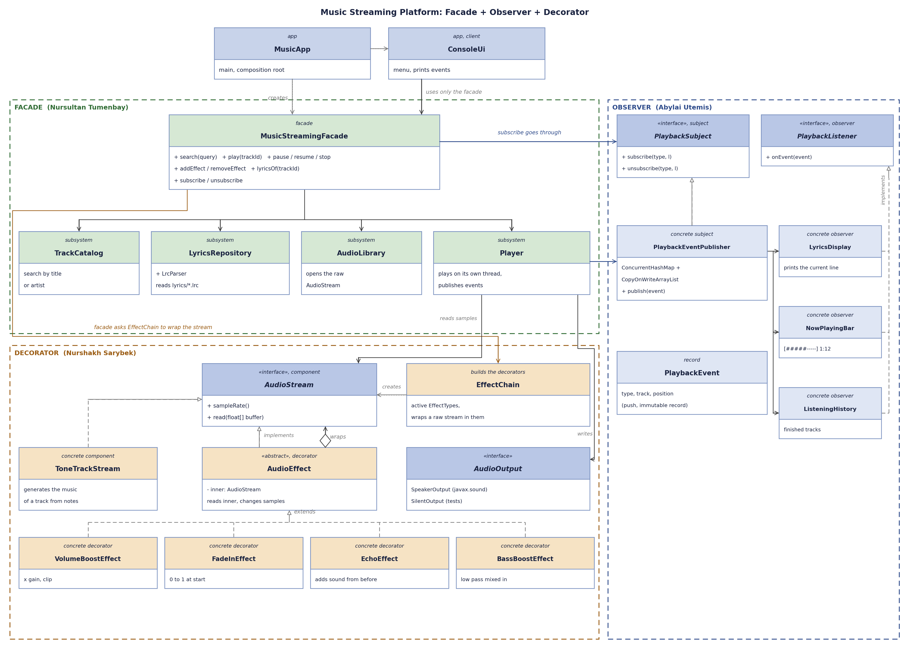

# Final Project SDP
# Topic: Music Streaming Platform
## Students: Nursultan Tumenbay, Abylai Utemis, Nurshakh Sarybek

Patterns: Facade (music library access), Observer (live track updates, lyrics display), Decorator (audio effects on the stream), Factory (creating effects), Strategy (playback order), Command (user actions and undo)

Architecture and folder structure: [docs/ARCHITECTURE.md](docs/ARCHITECTURE.md)

The diagram shows Facade, Observer and Decorator. Factory, Strategy and Command are described in the architecture file



Run the web player (opens http://127.0.0.1:8080 in the browser):

```
./mvnw -q compile exec:java -Dexec.mainClass=music.app.WebApp
```

Options: `--silent` (no sound, for laptops without speakers), `--port=8081`, `--no-browser`. The page is in `src/main/resources/web/index.html`: a pixel mp3 player, the click wheel has menu, previous, next and play / pause, the keys under it toggle effects, change the playback order and undo

Run the console version and the tests:

```
./mvnw -q compile exec:java
./mvnw test
```

Commands:

```
list | search <text>
play <id> | pause | resume | stop | next
queue [<id>] | order sequential|shuffle|repeat
add <effect> | remove <effect> | effects | undo
now | history | exit
effects: volume_boost, fade_in, echo, bass_boost
```
